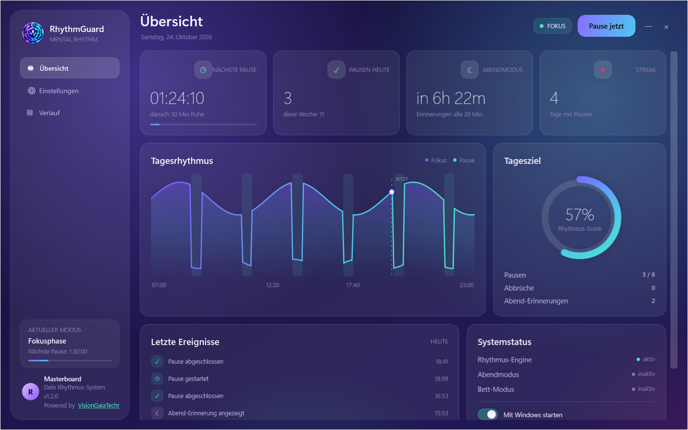
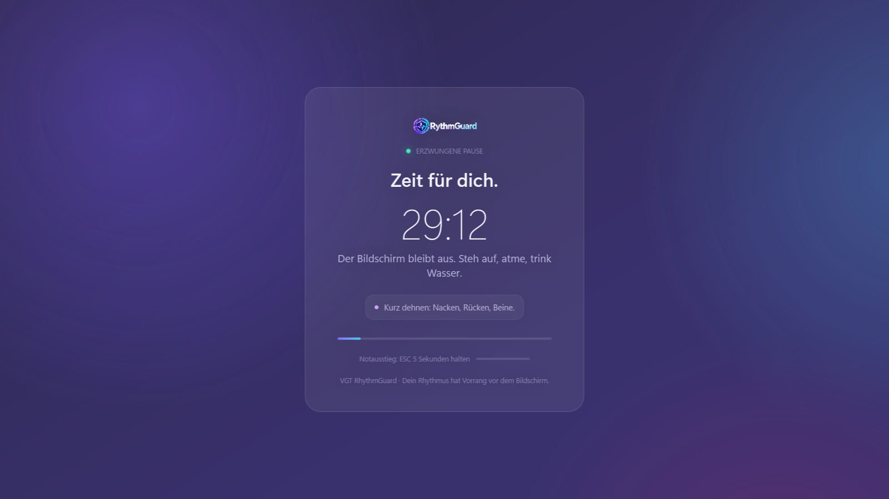
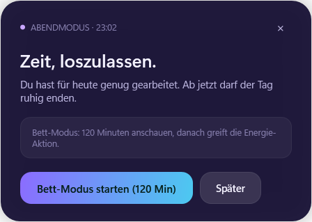
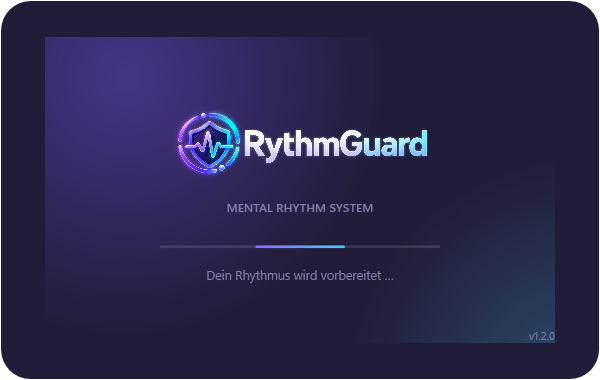
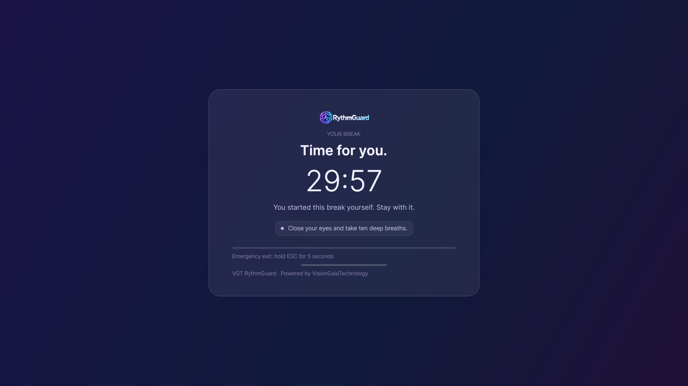

# VGT Rhythm Guard

<p align="center">
  
</p>

<p align="center">
  <strong>A mental-health rhythm system that anchors breaks, evenings and sleep directly into your Windows session.</strong><br />
  No coaching you can click away — a reliable frame for a healthier rhythm.
</p>

<p align="center">
  <a href="https://github.com/visiongaiatechnology/rythmguard/actions/workflows/build.yml">
    
  </a>
  
  
  
  
</p>

<p align="center">
  <strong>English</strong> ·
  <a href="README.de.md">Deutsch</a> ·
  <a href="README.es.md">Español</a> ·
  <a href="README.it.md">Italiano</a> ·
  <a href="README.ru.md">Русский</a> ·
  <a href="README.zh.md">中文</a> ·
  <a href="README.ja.md">日本語</a>
</p>

---

<p align="center">
  <a href="https://github.com/visiongaiatechnology/rythmguard/releases/tag/v1.2.0-beta.1"></a>
  <a href="https://github.com/visiongaiatechnology/rythmguard/releases/tag/v1.3.0-linux-beta.1"></a>
</p>

## ⬇️ Download

| Platform | Version | Download |
|---|---|---|
| 🪟 **Windows 10/11 x64** | **1.2.0 Beta** | [**Windows installer**](https://github.com/visiongaiatechnology/rythmguard/releases/download/v1.2.0-beta.1/VGT-RhythmGuard-Setup-1.2.0-Beta.exe) · [Release notes](https://github.com/visiongaiatechnology/rythmguard/releases/tag/v1.2.0-beta.1) |
| 🐧 **Linux x64** | **1.3.0 Beta** | [**AppImage (recommended)**](https://github.com/visiongaiatechnology/rythmguard/releases/download/v1.3.0-linux-beta.1/VGT-RhythmGuard-1.3.0-linux-x86_64.AppImage) · [Tarball](https://github.com/visiongaiatechnology/rythmguard/releases/download/v1.3.0-linux-beta.1/VGT-RhythmGuard-1.3.0-linux-x64.tar.gz) · [Release notes](https://github.com/visiongaiatechnology/rythmguard/releases/tag/v1.3.0-linux-beta.1) |

> Windows: per-user installer — no administrator rights required. Linux: AppImage is the easiest way (chmod +x and run). More releases: [https://github.com/visiongaiatechnology/rythmguard/releases](https://github.com/visiongaiatechnology/rythmguard/releases).
## Why Rhythm Guard?

Long work sessions, a PC that stays on for days and screens that stay lit at night slowly
erode sleep and mental health. Rhythm Guard turns Windows into a fixed frame:

- **Forced breaks** block the screen for a configurable time during the day.
- **Evening mode** reminds you every 20 minutes not to keep working after 23:00.
- **Bed mode** gives you a configurable window (default: 2 h) and then forces the PC into
  sleep or shutdown.
- **Fully local:** no account, no cloud, no telemetry.

## Features

| Mode | Default window | Behavior |
|---|---|---|
| **Focus** | 07:00 – 23:00 | Work in cycles (120 min), then |
| **Break** | every 120 min, 30 min long | Fullscreen glass overlay on every monitor, screen blocked |
| **Evening** | 23:00 – 07:00 | Quiet reminder every 20 min: stop working, wind down |
| **Bed** | manual / evening reminder | Configurable window (120 min) to watch something, then sleep, hibernate or shutdown |

- **Aurora Glass UI** — dashboard with live status, daily rhythm chart, rhythm score, event
  history and system status. Localized in **7 languages**.
- **Emergency exit** — hold `ESC` for 5 seconds and type `PAUSE` (can be disabled as “hardcore”).
- **Power actions** — sleep, hibernate, gentle or hard shutdown with warnings at 5 min,
  1 min and a 60-second fullscreen countdown.
- **Local persistence** — atomic JSON config/state and a 90-day JSONL event history.
- **Tray-first** — runs quietly in the notification area; the dashboard opens on demand.

## Screenshots

| Dashboard | Enforced break |
|---|---|
|  |  |

| Evening reminder | Bed countdown | Splash |
|---|---|---|
|  |  |  |

More: [`docs/screenshots/`](docs/screenshots/) · Design language: [`docs/DESIGN.md`](docs/DESIGN.md)

## Linux

A **1:1 Linux port** is included in `src/VGT.RhythmGuard.App.Linux` (Avalonia UI, .NET 10, Linux x64).
It ships the same scheduler, forced-break overlay, evening mode, bed mode with systemd power actions,
XDG autostart, single-instance protection, Aurora Glass dashboard and 7-language UI.



| Linux build | Linux package |
|---|---|
| `dotnet build src/VGT.RhythmGuard.App.Linux/... -c Release` | `bash scripts/publish-linux.sh` (tarball) |
| UI selftest: `... -- --selftest` | `bash scripts/build-appimage.sh` (AppImage) |

CI: [`.github/workflows/linux.yml`](.github/workflows/linux.yml) ·
Release: [`.github/workflows/linux-release.yml`](.github/workflows/linux-release.yml) ·
Details & limitations: [`docs/LINUX.md`](docs/LINUX.md)

**Beta limitations:** fullscreen blocking is reliable on X11; on Wayland it depends on the compositor
(wlr-layer-shell). Tray requires StatusNotifier/AppIndicator support (GNOME needs an extension).
Power actions use `systemctl` and may require polkit confirmation.
## Requirements

- Windows 10 (1809+) or Windows 11, x64
- [.NET SDK 10](https://dotnet.microsoft.com/) to build from source
- No administrator rights required at runtime (autostart uses `HKCU`)

## Installation

The repository contains the **source** and the installer definition. Build a per-user
installer locally:

```powershell
# 1. Build the self-contained app (creates dist\VGT.RhythmGuard.exe)
powershell -ExecutionPolicy Bypass -File scripts\publish.ps1

# 2. Optional: compile the Inno Setup installer (requires Inno Setup 6+)
#    Open installer\VGT-RhythmGuard.iss with Inno Setup or run ISCC.exe on it.
#    Output: dist-installer\VGT-RhythmGuard-Setup-<version>.exe

# 3. Optional: register autostart for the current user (no admin needed)
powershell -ExecutionPolicy Bypass -File scripts\install-autostart.ps1 -StartNow
```

The installer targets `%LOCALAPPDATA%\Programs\VGT Rhythm Guard`, creates Start-menu and
optional desktop shortcuts and offers an optional “Start with Windows” task.

> **SmartScreen:** locally built executables are not code-signed. Windows may ask once —
> choose *More information → Run anyway*. Code signing is recommended for public releases.

## Build from source

```powershell
dotnet restore VGT.RhythmGuard.slnx
dotnet build VGT.RhythmGuard.slnx -c Release

# Run the Core fact suite (testhost-free runner, 32 facts)
dotnet run --project tools\VGT.RhythmGuard.FactRunner -c Release

# Standard xUnit tests
dotnet test tests\VGT.RhythmGuard.Core.Tests\VGT.RhythmGuard.Core.Tests.csproj
```

## Configuration & data

All data stays on the machine, under `%LOCALAPPDATA%\VGT\RhythmGuard`:

| File | Purpose |
|---|---|
| `config.json` | validated settings (day window, work/break, evening, bed, language) |
| `state.json` | active bed session and power-action guard |
| `events.jsonl` | event history, retention 90 days |
| `app.log` | diagnostic log |

Default configuration:

```json
{
  "DayStart": "07:00:00",
  "DayEnd": "23:00:00",
  "WorkMinutes": 120,
  "BreakMinutes": 30,
  "EveningReminderMinutes": 20,
  "BedModeMinutes": 120,
  "BedModePowerAction": "Sleep",
  "EmergencyHoldSeconds": 5,
  "EveningRemindersEnabled": true,
  "StartWithWindows": false,
  "StatsRetentionDays": 90,
  "UiLanguage": "system"
}
```

## Architecture

- `VGT.RhythmGuard.Core` — pure, testable domain: validated settings, stateless scheduler
  engine, snapshot/event/statistics models, typed exception hierarchy. No Windows or UI
  dependencies.
- `VGT.RhythmGuard.App` — WPF shell: coordinator, tray, glass overlays, settings dashboard,
  localization, persistence, power and autostart services.
- `tools/VGT.RhythmGuard.FactRunner` — executes the xUnit facts without the VSTest testhost
  (useful in restricted environments).

Details: [`ARCHITECTURE.md`](ARCHITECTURE.md)

## Tests

| Check | Status |
|---|---|
| Core fact suite (`FactRunner`) | 32 facts — run in CI |
| xUnit tests (`dotnet test`) | run in CI |
| Build (`dotnet build -c Release`) | run in CI |
| CI workflow | [`.github/workflows/build.yml`](.github/workflows/build.yml) |

Badges above reflect the actual CI workflow; test results are not claimed without execution.

## Security & limitations

- No network access, no telemetry, no cloud account.
- The app is not a security boundary: `Ctrl+Alt+Del`, Task Manager and sign-out always work.
- Signed release builds are recommended for wider distribution; current builds are unsigned.
- Overlay positioning assumes uniform display scaling; mixed-DPI multi-monitor setups are
  supported on a best-effort basis.

Please report vulnerabilities privately — see [`SECURITY.md`](SECURITY.md).

## Localization

The UI and README are available in **Deutsch, English, Español, Italiano, Русский, 中文, 日本語**.
Language selection lives in *Settings → System → Sprache / Language*.

## Contributing

Bug reports, feature ideas and pull requests are welcome — see [`CONTRIBUTING.md`](CONTRIBUTING.md)
and [`CHANGELOG.md`](CHANGELOG.md).

## License

GNU Affero General Public License v3.0 — see [`LICENSE`](LICENSE).
Third-party components and asset origins: [`THIRD_PARTY_NOTICES.md`](THIRD_PARTY_NOTICES.md).

---

<p align="center">
  <sub>Powered by <a href="https://visiongaiatechnology.de">VisionGaiaTechnology</a></sub>
</p>
